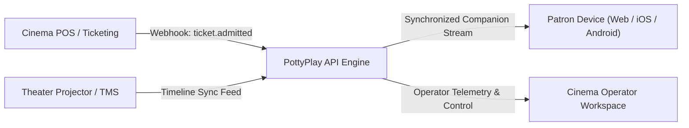

# PottyPlay Cinema Integration Guide

This guide describes how cinema technology teams, ticketing vendors, and Theater Management System (TMS) engineers integrate with PottyPlay.

---

## 1. Integration Topology

PottyPlay connects with two primary cinema systems:

1. **Point-of-Sale (POS) Ticketing**: Provisions admission entitlements, valid ticket numbers, and optional claim tokens.
2. **Theater Management System (TMS)**: Communicates authoritative auditorium projection state, current playback timecode, and emergency pause events.



---

## 2. Authentication and Security

- **Server-to-Server API Keys**: Provided to approved cinema exhibitors. Sent via `X-Cinema-Key` header.
- **Client Session Tokens**: Cryptographically random strings prefixed with `pstk_` (companion playback) or `cust_` (customer persistent session).
- **Transport Security**: TLS 1.3 mandatory across all endpoints.
- **Idempotency**: All state-modifying requests (`/api/sessions/activate`) accept an `Idempotency-Key` header to prevent duplicate activation or multiple billing charges during network retries.

---

## 3. Core API Endpoints

### 3.1 Verify Ticket Entitlement
`POST /api/tickets/verify`

Validates that a ticket barcode or claim token corresponds to a valid admission for an active screening.

```json
// Request
{
  "ticketNumber": "CC-MLM-7821-A12",
  "screeningId": "screening_prime_01"
}

// Response (200 OK)
{
  "isEligible": true,
  "status": "ELIGIBLE",
  "ticket": {
    "ticketNumber": "CC-MLM-7821-A12",
    "seatNumber": "A12",
    "customerName": "Juma Mwanamvua"
  },
  "screening": {
    "id": "screening_prime_01",
    "title": "Serengeti Shadows (Main Hall)",
    "cinemaName": "Century Cinemax - Mlimani City"
  },
  "rights": {
    "maxSessionDurationSeconds": 900,
    "licenseType": "Authorized Exhibitor Trial"
  }
}
```

### 3.2 Activate Bathroom Session
`POST /api/sessions/activate`

Atomically activates a 900-second session. Enforces the strict 2-break limit per ticket.

```json
// Request
{
  "ticketNumber": "CC-MLM-7821-A12",
  "deviceInfo": "Safari on iOS 18 (Mobile)"
}

// Response (200 OK)
{
  "success": true,
  "sessionId": "session_88192a_cuid",
  "sessionToken": "pstk_e92bf18a032d88...",
  "durationSeconds": 900,
  "initialPlaybackPositionSeconds": 720.0
}
```

### 3.3 Authoritative Synchronization
`GET /api/sessions/sync`

Header: `x-session-token: pstk_e92bf18a032d88...`

Returns current authoritative playback position, pause state, and remaining seconds.

---

## 4. Ticketing POS Webhooks

Exhibitor POS systems send webhooks to `https://api.pottyplay.co.tz/webhooks/pos`:

- `ticket.admitted`: Provisions ticket entitlement when scanned at theater turnstiles.
- `ticket.refunded`: Immediately revokes companion authorization if a ticket is refunded.

---

## 5. Certification and Sandbox

Partners receive sandbox credentials upon administrative approval. The sandbox runs against isolated fixtures at `https://sandbox.pottyplay.co.tz`.
