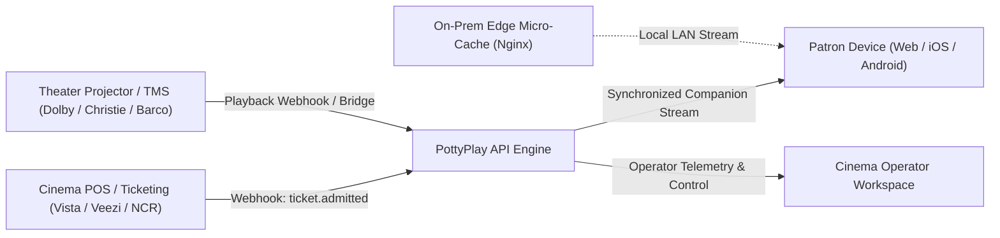

# PottyPlay Cinema Integration Guide

This guide describes how cinema technology teams, ticketing vendors, and Theater Management System (TMS) engineers integrate with PottyPlay.

---

## 1. Integration Topology

PottyPlay connects with three primary cinema systems:

1. **Point-of-Sale (POS) Ticketing**: Provisions admission entitlements, valid ticket numbers, admission prices, and optional claim tokens.
2. **Theater Management System (TMS)**: Communicates authoritative auditorium projection state, current playback timecode, and emergency pause/stop events.
3. **In-Auditorium Local Edge Streaming Micro-Server**: Caches companion video streams inside the cinema LAN to bypass basement Faraday cages and degraded cellular reception.



---

## 2. Authentication and Security

- **Server-to-Server API Keys**: Provided to approved cinema exhibitors. Sent via `X-Cinema-Key` header.
- **Client Session Tokens**: Cryptographically random strings prefixed with `pstk_` (companion playback) or `cust_` (customer persistent session).
- **Session Token Hashing at Rest**: All `BreakSession` bearer tokens and `OperatorUser` sessions are stored as SHA-256 hashes (`sessionTokenHash`) in the PostgreSQL database.
- **POS Webhook Verification**: Inbound POS webhooks must include an HMAC-SHA256 signature in `x-pos-signature` computed over `timestamp.body` using the cinema's configured webhook secret. Requests older than 300 seconds are rejected to prevent replay attacks.
- **Transport Security**: TLS 1.3 mandatory across all public endpoints.
- **Idempotency**: All state-modifying requests (`/api/sessions/activate`) accept an `Idempotency-Key` header to prevent duplicate activation or multiple billing charges during network retries.

---

## 3. Dynamic Percentage-Based Billing Model

Companion streaming fees are calculated dynamically as a percentage ($P_{\%}$) of the verified ticket admission price:

```
Fee = TicketPrice * (PercentageFee / 100)
```

- Default rate: 15% (configurable per cinema circuit or contract).
- For a $15.00 admission ticket at 15%, the companion streaming deduction is $2.25.
- Because tickets vary in price (matinee, child, VIP, premium large format), ticket verification on `/watch` is mandatory and unskippable for patrons entering via QR code to ensure correct mathematical deduction.
- Billing records store `ticketPrice`, `percentageFee`, `calculatedFee`, `currency`, and an atomic `idempotencyKey`.

---

## 4. Core API Endpoints

### 4.1 Verify Ticket Entitlement
`POST /api/tickets/verify`

Validates that a ticket barcode or claim token corresponds to a valid admission for an active screening. Ingests ticket price for billing.

```json
// Request
{
  "ticketNumber": "TK-8821-DEMO",
  "screeningId": "screening_auditorium_01"
}

// Response (200 OK)
{
  "isEligible": true,
  "status": "ELIGIBLE",
  "ticket": {
    "ticketNumber": "TK-8821-DEMO",
    "seatNumber": "D04",
    "customerName": "Patron Name",
    "price": 15.00,
    "currency": "USD"
  },
  "screening": {
    "id": "screening_auditorium_01",
    "title": "Screening Feature (Auditorium 1)",
    "cinemaName": "Partner Cinema Circuit"
  },
  "rights": {
    "maxSessionDurationSeconds": 900,
    "licenseType": "Authorized Exhibitor License"
  }
}
```

### 4.2 Activate Bathroom Session
`POST /api/sessions/activate`

Atomically activates a companion streaming session (up to 900 seconds). Enforces the strict 2-break limit per ticket.

```json
// Request
{
  "ticketNumber": "TK-8821-DEMO",
  "deviceInfo": "Safari on iOS 18 (Mobile)"
}

// Response (200 OK)
{
  "sessionId": "ses_9f81a7b3c2d4e5f6",
  "sessionToken": "pstk_0192837465abcde",
  "screeningId": "screening_auditorium_01",
  "streamUrl": "https://stream.pottyplay.internal/hls/screening_auditorium_01/manifest.m3u8",
  "currentPositionSeconds": 1420,
  "expiresAt": "2026-10-28T12:35:00.000Z",
  "maxDurationSeconds": 900,
  "breakNumber": 1,
  "remainingBreaks": 1
}
```

### 4.3 Synchronize Playback Timeline
`GET /api/sessions/sync?sessionToken=pstk_...`

Returns the authoritative projection timecode and pause state.

```json
// Response (200 OK)
{
  "currentPositionSeconds": 1435,
  "isPaused": false,
  "canFollow": true,
  "secondsRemaining": 885,
  "serverTimestamp": 1793183700000
}
```

---

## 5. POS Admission Webhook Specification

Point-of-Sale systems emit admission webhooks to notify PottyPlay when a ticket is purchased or scanned at the podium:

```http
POST /api/webhooks/pos
Content-Type: application/json
x-pos-signature: 7a8f... (HMAC-SHA256 hex digest)
x-pos-timestamp: 1793183700000

{
  "event": "ticket.admitted",
  "cinemaId": "cinema_circuit_01",
  "screeningId": "screening_auditorium_01",
  "ticketNumber": "TK-8821-DEMO",
  "seatNumber": "D04",
  "customerName": "Patron Name",
  "customerPhone": "+255714000111",
  "claimToken": "CLM-DEMO-9901",
  "ticketPrice": 15.00,
  "currency": "USD",
  "maxBreaks": 2,
  "maxSessionSeconds": 900
}
```

### Signature Computation Example (Node.js)

```typescript
import { createHmac } from "crypto";

const timestamp = Date.now().toString();
const payload = JSON.stringify(body);
const signature = createHmac("sha256", webhookSecret)
  .update(`${timestamp}.${payload}`)
  .digest("hex");

// Send headers:
// "x-pos-signature": signature
// "x-pos-timestamp": timestamp
```

---

## 6. TMS Projector Playback Automation Bridge

To synchronize auditorium projection without requiring manual clicks by cinema staff, PottyPlay provides:

1. **Webhook Ingestion**: `POST /api/webhooks/pos` handles projection state events:
   - `screening.playback_started`: Initializes or resumes projection timeline at `positionSeconds`.
   - `screening.playback_paused`: Freezes authoritative position.
   - `screening.playback_resumed`: Resumes authoritative timecode progression.
   - `screening.playback_stopped`: Terminates screening and concludes all active patron companion sessions.

2. **Daemon Adapter (`tms-bridge/`)**: An on-prem lightweight daemon (`tms-daemon.ts`) that polls or listens for SNMP/TCP/REST events from Dolby IMS, Christie IMB, Barco ICMP, or Vista Film Server and forwards authenticated HMAC webhooks to PottyPlay.

---

## 7. In-Auditorium Local Edge Streaming

Auditoriums and restrooms are often located in basements with reinforced concrete walls that attenuate cellular signal (Faraday cage effect).

PottyPlay supports local edge streaming:
- **Configuration**: Each cinema record in PostgreSQL includes `edgeStreamingEnabled`, `edgeServerUrl` (e.g., `http://192.168.10.50:8080/hls`), `venueWifiSsid` (e.g., `pottyplay-cinema-guest`), and `lanIpSubnets` (e.g., `192.168.10.0/24, 10.0.0.0/16`).
- **Edge Resolver (`src/lib/edge-streaming.ts`)**: When client devices initiate playback or connect via `/api/operator/edge`, the resolver inspects the client IP and cinema configuration:
  - If the client IP matches the cinema LAN subnets or the device is on venue Wi-Fi, stream requests are routed to the on-premise Nginx caching micro-server.
  - If external or off-network, requests gracefully fall back to the global CDN stream URL.
- **Micro-Cache Deployment**: A containerized Nginx caching proxy configuration is provided in `edge-server/nginx.conf` and `edge-server/docker-compose.edge.yml`.

---

## 8. OpenAPI 3.1 Specification

PottyPlay publishes a formal, machine-readable OpenAPI 3.1 contract at `/api/openapi.json`. 

- **Canonical Endpoint**: `GET /api/openapi.json`
- **Specification Version**: OpenAPI 3.1.0
- **Purpose**: Enables cinema engineering teams, POS vendors (Vista, Veezi, NCR Voyix), and Theater Management System (TMS) integrators to import endpoints directly into Postman, Insomnia, or automated SDK generators.
- **Interactive Documentation**: Available on the [Developer Portal](/developers).
