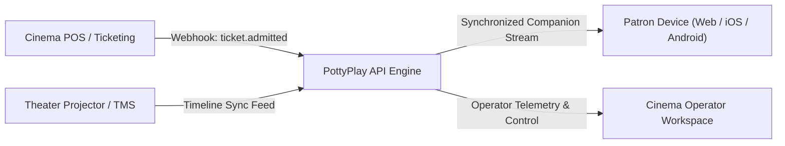

# PottyPlay Cinema Integration Guide

This guide describes how cinema technology teams, ticketing vendors, and Theater Management System (TMS) engineers integrate with PottyPlay.

---

## 1. Integration Topology

PottyPlay connects with two primary cinema systems:

1. **Point-of-Sale (POS) Ticketing**: Provisions admission entitlements, valid ticket numbers, and optional claim tokens.
2. **Theater Management System (TMS)**: Communicates authoritative auditorium projection state, current playback timecode, and emergency pause events.



---

## 2. Authentication and Security

- **Server-to-Server API Keys**: Provided to approved cinema exhibitors. Sent via `X-Cinema-Key` header.
- **Client Session Tokens**: Cryptographically random strings prefixed with `pstk_` (companion playback) or `cust_` (customer persistent session).
- **Transport Security**: TLS 1.3 mandatory across all endpoints.
- **Idempotency**: All state-modifying requests (`/api/sessions/activate`) accept an `Idempotency-Key` header to prevent duplicate activation or multiple billing charges during network retries.

---

## 3. Core API Endpoints

### 3.1 Verify Ticket Entitlement
`POST /api/tickets/verify`

Validates that a ticket barcode or claim token corresponds to a valid admission for an active screening.

```json
// Request
{
  "ticketNumber": "TK-8821-DEMO",
  "screeningId": "screening_auditorium_01"
}

// Response (200 OK)
{
  "isEligible": true,
  "status": "ELIGIBLE",
  "ticket": {
    "ticketNumber": "TK-8821-DEMO",
    "seatNumber": "D04",
    "customerName": "Patron Name"
  },
  "screening": {
    "id": "screening_auditorium_01",
    "title": "Screening Feature (Auditorium 1)",
    "cinemaName": "Partner Cinema Circuit"
  },
  "rights": {
    "maxSessionDurationSeconds": 900,
    "licenseType": "Authorized Exhibitor License"
  }
}
```

### 3.2 Activate Bathroom Session
`POST /api/sessions/activate`

Atomically activates a 900-second session. Enforces the strict 2-break limit per ticket.

```json
// Request
{
  "ticketNumber": "TK-8821-DEMO",
  "deviceInfo": "Safari on iOS 18 (Mobile)"
}

// Response (200 OK)
{
  "sessionId": "ses_9f81a7b3c2d4e5f6",
  "sessionToken": "pstk_0192837465abcde",
  "screeningId": "screening_auditorium_01",
  "streamUrl": "https://stream.pottyplay.internal/hls/screening_auditorium_01/manifest.m3u8",
  "currentPositionSeconds": 1420,
  "expiresAt": "2026-10-28T12:35:00.000Z",
  "maxDurationSeconds": 900,
  "breakNumber": 1,
  "remainingBreaks": 1
}
```

### 3.3 Synchronize Playback Timeline
`GET /api/sessions/sync?sessionToken=pstk_...`

Returns the authoritative projection timecode.

```json
// Response (200 OK)
{
  "currentPositionSeconds": 1435,
  "isPaused": false,
  "canFollow": true,
  "secondsRemaining": 885,
  "serverTimestamp": 1793183700000
}
```

---

## 4. Ticketing Webhook Specification

Exhibitor POS systems emit admission events to PottyPlay:

```http
POST /api/webhooks/pottyplay/tickets
Content-Type: application/json
X-PottyPlay-Signature: sha256=...

{
  "event": "ticket.admitted",
  "cinemaId": "cinema_circuit_01",
  "screeningId": "screening_auditorium_01",
  "ticketNumber": "TK-8821-DEMO",
  "seatNumber": "D04",
  "customerName": "Patron Name",
  "customerPhone": "+255714000111",
  "claimToken": "CLM-DEMO-9901",
  "maxBreaks": 2,
  "maxSessionSeconds": 900
}
```

---

## 5. OpenAPI 3.1 Specification

PottyPlay publishes a formal, machine-readable OpenAPI 3.1 contract at `/api/openapi.json`. 

- **Canonical Endpoint**: `GET /api/openapi.json`
- **Specification Version**: OpenAPI 3.1.0
- **Purpose**: Enables cinema engineering teams, POS vendors (Vista, Veezi, NCR Voyix), and Theater Management System (TMS) integrators to import endpoints directly into Postman, Insomnia, or automated SDK generators (TypeScript, Python, C#, Go).
- **Interactive Documentation**: Available on the [Developer Portal](/developers).
